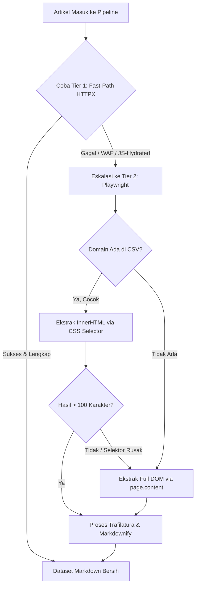

# KATALOG LENGKAP & PERBANDINGAN CSS SELECTOR PATH PER DOMAIN MEDIA

Dokumen ini mendokumentasikan pemetaan, perbedaan teknis, dan karakteristik **CSS Selector Path** dari berbagai portal berita di Indonesia. File ini berfungsi sebagai panduan acuan untuk pemeliharaan file konfigurasi [`Scrapper/sample_css_paths.csv`](file:///e:/Coding/Coding/KOMDIGI/Crawler%20Mas%20Anjas/Scrapper/sample_css_paths.csv) serta referensi saat menambahkan media baru ke sistem crawler.

---

## 1. Mengapa CSS Selector Setiap Media Berbeda?

Setiap portal berita memiliki struktur kode HTML dan penamaan class/ID CSS yang berbeda karena:
1. **Perbedaan Frontend Framework & Library:**
   - Situs berbasis React / Next.js (seperti *Kumparan* atau *Inilah.com*) kerap memakai CSS-in-JS (*Styled Components*, *Emotion*, atau *Material-UI*) yang menghasilkan penamaan class dinamis atau berformat utility seperti `MuiContainer-root` atau `StoryBody`.
2. **In-House Template Konglomerasi Media:**
   - Grup media besar membangun ekosistem frontend proprietary mereka sendiri:
     - **Transmedia** (*Detik*, *CNN Indonesia*, *CNBC Indonesia*) memakai pola penamaan class `detail__...` atau `detail-...`.
     - **Kompas Gramedia / KG Media** (*Kompas*, *Tribunnews*, *Kontan*) memakai pola `read__content`, `txt-article`, atau `content-news`.
     - **KapanLagi Youniverse / KLY** (*Liputan6*, *Merdeka*) memakai pola `article-content-body`.
3. **Platform CMS Standar (WordPress / Drupal):**
   - Sebagian besar media lokal, independen, dan portal rilis pers menggunakan WordPress yang memiliki penamaan standar seperti `.entry-content`, `.post-content`, atau tag semantik `<article>`.
4. **Strategi Penempatan Iklan & Anti-AdBlock:**
   - Banyak media memecah artikel menjadi puluhan blok `<div>` kecil yang diselingi slot iklan banner atau widget rekomendasi berita *"Baca Juga"*, sehingga selektor harus membidik pembungkus induk yang paling bersih.

---

## 2. Tabel Komparasi CSS Selector Path Lengkap

Berikut adalah tabel rincian selektor utama, selektor alternatif, serta karakteristik DOM untuk masing-masing domain yang telah dipetakan:

| No | Media / Portal | Domain | Primary CSS Selector | Fallback / Alt Selector | Karakteristik DOM & Platform |
| :---: | :--- | :--- | :--- | :--- | :--- |
| 1 | **Detikcom** | `detik.com` | `div.detail__body-text` | `article.detail` | Custom frontend Transmedia. Teks terbungkus rapi di dalam div detail, namun kerap memuat tag `table.linksisip` ("Baca Juga"). |
| 2 | **Kompas.com** | `kompas.com` | `div.read__content` | `div.read__article, article` | Custom KG Media. Sering membagi berita menjadi multi-halaman (`?page=all`) dengan iklan sisipan di antara tag `<p>`. |
| 3 | **CNN Indonesia** | `cnnindonesia.com` | `div.detail-text` | `div#detikdetailtext` | Transmedia template. Menggunakan class `detail-text` dengan ID cadangan `detikdetailtext` dari warisan engine Detik. |
| 4 | **CNBC Indonesia** | `cnbcindonesia.com` | `div.detail_text` | `div.detail-box` | Transmedia template. Sedikit berbeda dengan CNN (menggunakan garis bawah `detail_text` alih-alih strip). |
| 5 | **Tempo.co** | `tempo.co` | `div.detail-konten` | `article.detail-artikel, div#isi` | Custom in-house engine. Menggunakan bahasa Indonesia baku (`detail-konten` atau `div#isi`). |
| 6 | **Kumparan** | `kumparan.com` | `div[class*='StoryBody']` | `div.story-body, article` | SPA React. Menggunakan class ter-hash dari Styled Components, sehingga selektor wildcard `[class*='StoryBody']` wajib digunakan. |
| 7 | **Inilah.com** | `inilah.com` | `div.MuiContainer-root p` | `div[class*='MuiBox'] p, article` | Next.js + Material-UI (MUI). Seluruh isi paragraf dibungkus oleh komponen `MuiContainer` dan `MuiBox`. |
| 8 | **Liputan6** | `liputan6.com` | `div.article-content-body` | `div.article-content` | KLY Group framework. Paragraf berita terstruktur jelas di dalam kontainer `article-content-body`. |
| 9 | **Merdeka.com** | `merdeka.com` | `div.articles-content` | `div.articles-content__body` | KLY Group framework. Mirip dengan Liputan6 namun menggunakan bentuk jamak (`articles-content`). |
| 10 | **Antara News** | `antaranews.com` | `div.post-content` | `div.article-content` | LKBN Antara. Struktur berita straight-news klasik dengan penamaan standar WordPress/CMS editorial. |
| 11 | **Tirto.id** | `tirto.id` | `div.content-text-editor` | `div.reading-content` | Media jurnalisme presisi. Paragraf berita dan infografis dibungkus dalam class editor khusus. |
| 12 | **Bisnis.com** | `bisnis.com` | `div.detailsContent` | `div.art-content` | Jaringan Bisnis Indonesia. Menggunakan format camelCase (`detailsContent`). |
| 13 | **Kontan** | `kontan.co.id` | `div.content-news` | `div.tm-article` | KG Media (Ekonomi/Keuangan). Format straight-forward dengan `div.content-news`. |
| 14 | **Katadata** | `katadata.co.id` | `div.detail-body` | `article.article-detail` | Media data & analisis. Menggunakan tag semantik `article` dan class `detail-body`. |
| 15 | **Republika** | `republika.co.id` | `div.article-content` | `div.artikel` | Portal berita nasional. Menggunakan class standar editorial `article-content`. |
| 16 | **Suara.com** | `suara.com` | `div.content-article` | `div.detail-berita` | Portal Arkadia Digital Media. Penamaan terbalik (`content-article` alih-alih `article-content`). |
| 17 | **Sindonews** | `sindonews.com` | `div.article-content` | `div#content` | MNC Media Network. Memiliki ID fallback `div#content`. |
| 18 | **Media Indonesia** | `mediaindonesia.com` | `div.article-content` | `div.detail-content` | Media Group Network. Menggunakan class `article-content`. |
| 19 | **Jawa Pos** | `jawapos.com` | `div.content` | `div.content-details` | Jawa Pos Group. Menggunakan penamaan ringkas `div.content`. |
| 20 | **Viva.co.id** | `viva.co.id` | `div.main-content` | `div.article-detail` | Visi Media Asia. Menggunakan kontainer `main-content`. |
| 21 | **IDN Times** | `idntimes.com` | `div.article-content` | `div#article-content` | IDN Media. Kontainer artikel standar berbasis ID dan class kembar. |
| 22 | **Tribunnews** | `tribunnews.com` | `div.txt-article` | `div#article` | KG Regional Network. Sangat khas dengan penamaan `div.txt-article` dan memiliki banyak halaman paginasi. |
| 23 | **JPNN** | `jpnn.com` | `div.content-article` | `div.artikel` | Jawa Pos Network. Memakai class `content-article`. |
| 24 | **Komdigi / Instansi** | `komdigi.go.id` | `div.content` | `article, main, body` | Portal Pemerintahan. Menggunakan tag semantik HTML5 standar `<article>` dan `<main>`. |
| 25 | **Media WordPress / Lokal** | *General Domains* | `div.entry-content` | `div.post-content, article` | Standar 90% website media lokal atau blog berbasis WordPress di Indonesia. |
| 26 | **Default Universal Fallback** | *Unknown Domains* | `body` | `article, main` | Jaring pengaman otomatis v3.0: mengekstrak full DOM dan dibersihkan via *Trafilatura*. |

---

## 3. Bedah Kasus & Analisis Karakteristik Per Grup Media

### A. Grup Transmedia (`detik.com`, `cnnindonesia.com`, `cnbcindonesia.com`)
* **Pola:** Menamai kontainer berita dengan kata depan `detail` diikuti pemisah variatif.
  - Detik: `div.detail__body-text` (memakai standar BEM: Block Element Modifier).
  - CNN: `div.detail-text` (memakai tanda hubung kebab-case).
  - CNBC: `div.detail_text` (memakai garis bawah snake_case).
* **Tantangan:** Terdapat widget sisipan *"Baca Juga"* (`table.linksisip`) dan video player interaktif di tengah-tengah paragraf.
* **Solusi Sistem Kita:** Di Tier 1, Trafilatura otomatis membuang tabel sisipan tersebut. Di Tier 2, converter Markdownify kita menyaring tag `nav`, `aside`, dan `iframe`.

### B. Grup Kompas Gramedia (`kompas.com`, `tribunnews.com`, `kontan.co.id`)
* **Pola:** Menggunakan kata `read` atau `txt-article`.
  - Kompas: `div.read__content`
  - Tribunnews: `div.txt-article`
* **Tantangan:** Kebijakan monetisasi *multi-page view* (artikel 400 kata sering dipecah menjadi 3 halaman).
* **Solusi Sistem Kita:** Logika *Auto-Fallback Escalation* kita mendeteksi teks ekor *"Halaman Selanjutnya"* atau *"Baca Selengkapnya"*, lalu mengeskalasikan artikel ke Tier 2 Playwright untuk rendering dinamis atau meminta URL `?page=all`.

### C. Framework SPA & React Modern (`kumparan.com`, `inilah.com`)
* **Pola:** Class name di-generate oleh compiler CSS-in-JS secara dinamis saat build.
  - Kumparan: Class berubah pada setiap rilis build (contoh: `StoryBody-sc-12345-0`). Oleh karena itu, selektor wajib memakai pencocokan substring: `div[class*='StoryBody']`.
  - Inilah.com: Memakai Material-UI sehingga tag `<p>` terbungkus di dalam `div.MuiContainer-root`. Selektor efektif: `"h1, div.MuiContainer-root p, article"`.
* **Tantangan:** Server-Side Rendering (SSR) sering menyertakan payload JSON mentah (`__NEXT_DATA__` / *React Flight Data*).
* **Solusi Sistem Kita:** Menggunakan perbaikan *Noise Prevention* v3.0 (`page.content()` + regex purge script blocks) sehingga script JSON dan CSS emotion tidak pernah bocor ke teks akhir.

---

## 4. Panduan: Cara Menemukan CSS Selector Baru (DevTools Guide)

Jika Anda ingin menambahkan media baru ke file [`Scrapper/sample_css_paths.csv`](file:///e:/Coding/Coding/KOMDIGI/Crawler%20Mas%20Anjas/Scrapper/sample_css_paths.csv), ikuti langkah 4 langkah cepat ini:

1. **Buka Artikel di Browser:**
   - Buka Google Chrome atau Chromium, lalu buka salah satu URL artikel berita dari domain target.
2. **Inspeksi Elemen Teks (Inspect Element):**
   - Klik kanan pada salah satu paragraf isi berita $\to$ pilih **Inspect** (atau tekan `F12` / `Ctrl + Shift + I`).
3. **Cari Pembungkus Induk Terdekat (*Parent Container*):**
   - Di tab **Elements**, telusuri tag pembungkus ke atas (*parent node*) hingga menemukan `<div>` atau `<article>` yang membungkus **seluruh paragraf berita** tanpa membungkus sidebar rekomendasi atau footer.
   - Catat atribut `class` atau `id` dari kontainer tersebut (misal: `<div class="story-content">`).
4. **Uji Validitas Selektor di Console:**
   - Pindah ke tab **Console** di DevTools, lalu jalankan perintah:
     ```javascript
     document.querySelector("div.story-content").innerText
     ```
   - Jika teks yang muncul di console adalah isi berita lengkap tanpa footer/komentar, maka selektor tersebut valid!
5. **Tambahkan ke CSV:**
   - Buka [`Scrapper/sample_css_paths.csv`](file:///e:/Coding/Coding/KOMDIGI/Crawler%20Mas%20Anjas/Scrapper/sample_css_paths.csv), lalu tambahkan baris baru di baris terbawah:
     ```csv
     namadomain.com;"div.story-content, article"
     ```

---

## 5. Mengapa Sistem Kita Tidak Lagi Rapuh Jika CSS Selector Berubah?

Pada arsitektur Crawler v3.0, CSS selector di atas **hanya berfungsi sebagai akselerator presisi (*Sniper Mode*)**:



1. **Tier 1 (Fast-Path) Bebas Selektor:** 80%–90% artikel diselesaikan di Tier 1 tanpa membaca CSS selector sama sekali, mengandalkan *Trafilatura heuristic parser*.
2. **Zero Failure Guarantee di Tier 2:** Jika situs media melakukan redesain dan class CSS-nya berubah, crawler otomatis jatuh ke jaring pengaman `page.content()` sehingga proses ekstraksi tetap 100% berhasil dan tidak menghasilkan data kosong.
