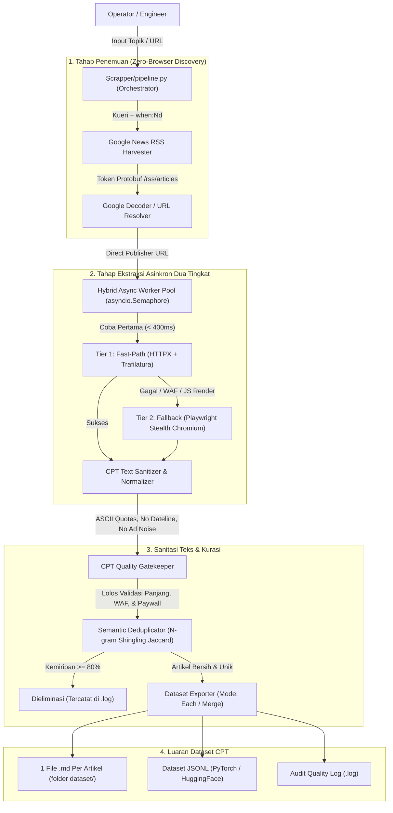

# AITF Crawler Engine & CPT Dataset Pipeline Ecosystem

Repositori ini berisi ekosistem lengkap untuk crawling dan ekstraksi data berbasis web yang dirancang khusus untuk menghasilkan dataset berkualitas tinggi bagi kebutuhan **Continual Pre-Training (CPT) & Fine-Tuning Large Language Models (LLM)**.

Sistem ini menggabungkan dua engine utama:
1. **Python Hybrid Pipeline (Scrapper v3.1):** Pipeline ekstraksi modern dengan arsitektur asinkron dua tingkat (*Fast-Path HTTPX + Playwright Stealth*), sanitasi tipografi ramah tokenizer LLM (ASCII quotes, pembersihan dateline & derau berita), deduplikasi semantik N-gram, ekspor 1 artikel per file Markdown, dan integrasi Google News RSS dengan *automatic URL decoding*.
2. **AITF Binary Engine:** Binary executable multi-platform (Windows, Linux, macOS) untuk crawling Google Search dan Google Images volume besar.

---

## 📑 Daftar Isi

- [Arsitektur Sistem](#-arsitektur-sistem)
- [Struktur Direktori](#-struktur-direktori)
- [Fitur Utama & Keunggulan](#-fitur-utama--keunggulan)
- [Sanitasi Teks Khusus Training LLM](#-sanitasi-teks-khusus-training-llm)
- [Keamanan & Konfigurasi Lingkungan (.env)](#-keamanan--konfigurasi-lingkungan-env)
- [Instalasi & Persiapan](#-instalasi--persiapan)
- [Panduan Penggunaan CLI](#-panduan-penggunaan-cli)
  - [1. One-Click Pipeline Orchestrator (Rekomendasi Utama)](#1-one-click-pipeline-orchestrator-rekomendasi-utama)
  - [2. Scraper CLI Mandiri (Playwright / Selenium)](#2-scraper-cli-mandiri-playwright--selenium)
  - [3. Google News RSS Harvester & URL Discovery](#3-google-news-rss-harvester--url-discovery)
  - [4. AITF Binary Engine (Google Search & Image)](#4-aitf-binary-engine-google-search--image)
- [Format Luaran Dataset](#-format-luaran-dataset)
- [Pengujian QA & Regresi](#-pengujian-qa--regresi)
- [Dokumentasi Tambahan](#-dokumentasi-tambahan)
- [Kontributor & Lisensi](#-kontributor--lisensi)

---

## 🏛 Arsitektur Sistem



---

## 📁 Struktur Direktori

```text
.
├── .env.example             # Template konfigurasi environment (bebas dari kredensial)
├── .gitignore               # Aturan pengabaian Git (mencegah kebocoran .env dan output)
├── CHANGELOG.md             # Log pembaruan arsitektur, bug hunting, dan hasil benchmark
├── README.md                # Dokumentasi komprehensif repositori (dokumen ini)
├── css_selector_path_list.md # Katalog CSS selector 26+ portal media & panduan DevTools
├── Linux/                   # Binary AITF Engine dan skrip instalasi untuk OS Linux
├── MacOS/                   # Binary AITF Engine dan skrip instalasi untuk OS macOS
├── Windows/                 # Binary AITF Engine dan skrip instalasi untuk OS Windows
└── Scrapper/                # Modul Python CPT Scraper & Pipeline Orchestrator
    ├── pipeline.py          # Unified Pipeline Orchestrator (Opsi 1, 2, 3, 5)
    ├── scraper.py           # Standalone Web Content Scraper (Playwright & Selenium)
    ├── google_news_crawler.py # Google News RSS Harvester & URL Discovery
    ├── sample_css_paths.csv # Pemetaan CSS Selector presisi 30+ media berita nasional
    ├── sample_urls.txt      # Berkas contoh daftar URL
    ├── test_qa_suite.py     # Test suite otomatis (27 pengujian unit & regresi)
    ├── requirements.txt     # Daftar dependensi dasar Python
    └── output/              # Folder penyimpanan hasil dataset (diabaikan git)
```

---

## 🌟 Fitur Utama & Keunggulan

1. **Async Concurrency Pool (Opsi 1):** Manajemen konkurensi asinkron berbasis `asyncio.Semaphore` yang mengeksekusi puluhan URL secara simultan dengan proteksi alokasi memori browser.
2. **Hybrid Fast-Path Two-Tier (Opsi 2):**
   - **Tier 1 (Fast-Path):** HTTPX asynchronous direct fetch + Trafilatura untuk halaman berita statis/SSR. Memproses artikel hanya dalam waktu **90ms – 600ms** tanpa beban memori browser.
   - **Tier 2 (Browser Fallback):** Playwright Chromium dengan skrip stealth (`navigator.webdriver = undefined`), toleransi SSL daerah (`ignore_https_errors=True`), dan penanganan rendering React/Next.js/SPA.
3. **Semantic Deduplication (Opsi 3):** Deteksi berita sindikasi rilis pers kembar menggunakan N-gram Word Shingling ($k=2$). Menggabungkan metrik **Jaccard Similarity** dan **Containment Overlap** dengan *short-stub false-positive guard* untuk mengeliminasi duplikasi di atas ambang batas (default $80\%$).
4. **Satu Artikel Satu File Markdown (`--output-mode each`):** Setiap artikel yang lolos kualifikasi diekspor menjadi satu berkas `.md` mandiri di dalam folder dataset target, memudahkan inspeksi dan pengolahan downstream.
5. **Auto-Switch Interpreter Pintar:** Otomatis mendeteksi dan beralih (*auto-spawn*) ke virtual environment `.venv` jika dijalankan dari shell Windows yang belum di-`activate`.
6. **Windows UTF-8 Stream Guard:** Proteksi encoding konsol Windows untuk mencegah galat `charmap cp1252` saat memproses karakter internasional (Ceko, Vietnam, Jepang, emoji).

---

## 🧼 Sanitasi Teks Khusus Training LLM

Sebelum teks dimasukkan ke dalam dataset, modul `sanitize_cpt_text()` melakukan kurasi data mendalam:

| Elemen | Karakter Asli Web | Hasil Normalisasi | Alasan untuk Tokenizer LLM |
| :--- | :--- | :--- | :--- |
| **Tanda Petik Ganda** | `“` `”` `«` `»` `„` `″` | `"` (ASCII 34) | Mencegah fragmentasi token ganda pada model BPE/SentencePiece. |
| **Apostrof & Petik Tunggal** | `‘` `’` `‚` `′` | `'` (ASCII 39) | Konsistensi kata serapan (*Jum'at*, *Al-Qur'an*). |
| **Tanda Hubung (Dash)** | `–` (en-dash), `—` (em-dash) | `2024-2026` / ` - ` | Menstandarkan rentang angka dan klausa jeda kalimat. |
| **Invisible Whitespace** | `\u00a0` (NBSP), `\u200b` (ZWSP), `\ufeff` | ` ` (Spasi biasa) | Menghilangkan karakter tak kasat mata yang merusak tokenisasi kata. |
| **Soft Hyphen** | `\u00ad` | `""` (dihilangkan) | Menyatukan kembali pemenggalan suku kata (*In-for-ma-si* $\to$ *Informasi*). |
| **Dateline Jurnalistik** | `JAKARTA, KOMPAS.com - ` | *(Dihapus)* | Kalimat langsung dimulai dari subjek berita tanpa bias lokasi berulang. |
| **Derau Inter-Artikel** | `Baca juga: ...`, `Simak video:` | *(Dihapus)* | Membuang interupsi promosi di tengah alur bacaan artikel. |
| **Footer Redaksi** | `Penulis: ... \| Editor: ...`, `(kcm/ard)` | *(Dihapus)* | Menghilangkan jejak inisial redaksi di akhir artikel. |

---

## 🔒 Keamanan & Konfigurasi Lingkungan (.env)

> [!CAUTION]
> **KEBIJAKAN KEAMANAN KREDENSIAL:**
> Seluruh token otentikasi, API keys, dan kredensial proxy **HANYA** boleh disimpan di dalam berkas lokal `.env` dan **TIDAK PERNAH** ditulis ke dalam repositori publik.

1. Salin berkas template `.env.example` menjadi `.env`:
   ```bash
   Copy-Item .env.example .env    # Windows PowerShell
   cp .env.example .env           # Linux / macOS
   ```
2. Buka berkas `.env` dan masukkan konfigurasi lokal Anda:
   ```env
   CRAWLER_ENGINE_TOKEN=masukkan_token_pribadi_anda_disini
   ```

---

## 📦 Instalasi & Persiapan

Disarankan menggunakan Python 3.10, 3.11, atau 3.12:

```bash
# 1. Buat dan aktifkan virtual environment
python -m venv .venv

# Di Windows (PowerShell):
..\.venv\Scripts\Activate.ps1
# Di Linux / macOS:
source .venv/bin/activate

# 2. Pasang paket dependensi utama
pip install -r Scrapper/requirements.txt
pip install trafilatura markdownify html2text httpx selectolax googlenewsdecoder

# 3. Unduh runtime browser Chromium untuk Playwright
python -m playwright install chromium
```

---

## 🚀 Panduan Penggunaan CLI

### 1. One-Click Pipeline Orchestrator (Rekomendasi Utama)

Berkas [`Scrapper/pipeline.py`](file:///e:/Coding/Coding/KOMDIGI/Crawler%20Mas%20Anjas/Scrapper/pipeline.py) adalah antarmuka terlengkap untuk membangun dataset CPT siap latih.

#### A. Crawling Berdasarkan Topik Berita (Google News RSS):
```bash
python -m Scrapper.pipeline --topic "Kecerdasan Buatan" --limit 50 --output Scrapper/output/dataset_ai
```

#### B. Crawling Berdasarkan Berkas Daftar URL Kustom:
```bash
python -m Scrapper.pipeline --urls daftar_url.txt --output Scrapper/output/dataset_manual
```

#### C. Crawling dengan GUI Browser (Headful Inspection):
```bash
python -m Scrapper.pipeline --topic "Komdigi" --limit 5 --headful
```

#### Daftar Argumen CLI `pipeline.py`:
| Argumen | Alias | Tipe | Default | Penjelasan |
|---|---|---|---|---|
| `--topic` | `-t`, `-q` | `str` | `None` | Kata kunci topik berita yang dicari di Google News RSS. |
| `--urls` | `-u` | `str` | `None` | Path berkas teks daftar URL lokal (satu baris satu URL). |
| `--when` | `-w` | `str` | `7d` | Filter batas waktu kebaruan berita (`1d`, `7d`, `30d`). |
| `--limit` | `-l` | `int` | `30` | Jumlah maksimal artikel yang diproses. |
| `--output` | `-o` | `str` | `Scrapper/output/dataset_cpt` | Path/folder target dataset luaran. |
| `--output-mode` | - | `str` | `each` | Mode simpan Markdown: `each` (1 artikel 1 file), `merge`, atau `both`. |
| `--format` | `-f` | `str` | `all` | Format luaran yang dihasilkan: `md`, `jsonl`, atau `all`. |
| `--concurrency` | `-c` | `int` | `8` | Batas jumlah *worker* paralel asinkron. |
| `--sim-threshold` | `-s` | `float` | `0.80` | Ambang batas kemiripan deduplikasi semantik (0.0 – 1.0). |
| `--css-paths` | - | `str` | `Scrapper/sample_css_paths.csv` | File CSV pemetaan selector CSS per domain portal media. |
| `--default-css` | - | `str` | `body` | Selector CSS cadangan jika domain tidak ada di CSV. |
| `--min-words` | - | `int` | `25` | Batas minimal kata artikel agar lolos CPT Quality Gate. |
| `--timeout` | - | `int` | `15` | Timeout per artikel dalam detik. |
| `--headful` | - | `flag` | `False` | Jalankan browser Playwright terlihat (GUI). |

---

### 2. Scraper CLI Mandiri (Playwright / Selenium)

Untuk kebutuhan scraping URL tertentu secara langsung:

```bash
# Mode default: 1 berkas .md per URL
python -m Scrapper.scraper --urls daftar_link.txt --output Scrapper/output/hasil_artikel/

# Mode gabung (merge) seluruh teks ke 1 berkas Markdown tunggal
python -m Scrapper.scraper --urls daftar_link.txt --output Scrapper/output/hasil.md --output-mode merge
```

---

### 3. Google News RSS Harvester & URL Discovery

Untuk mengumpulkan daftar URL artikel asli dari Google News tanpa mendownload artikelnya:

```bash
# Kueri umum (otomatis decode ke URL portal berita asli)
python -m Scrapper.google_news_crawler -q "Kecerdasan Buatan" -l 30 -o "daftar_link.txt"

# Kueri dengan operator pengecualian (menghindari rilis internal institusi)
python -m Scrapper.google_news_crawler -q "Komdigi -site:komdigi.go.id" -l 20 -o "daftar_link.txt"
```

---

### 4. AITF Binary Engine (Google Search & Image)

Untuk menjalankan binary crawler Google Search menggunakan token yang telah dikonfigurasi di file `.env`:

```bash
cd Windows
.\aitf-engine.exe crawl -k "Kecerdasan Buatan" --keyword-type=keywords
.\aitf-engine.exe extract-text -f output/crawler_url.txt
```

---

## 📊 Format Luaran Dataset

Dalam mode default (`--output-mode each`), pipeline menghasilkan subfolder khusus yang rapi:

```text
Scrapper/output/dataset_cpt_100/
├── article_001_unair_ac_id_dosen_ftmm_unair_jelaskan_dampak.md
├── article_002_mtsn4batanghari_mdrsh_id_kemenag_canva.md
├── article_003_tradingview_com_kecerdasan_buatan_kesehatan.md
├── ... (total 97 file artikel terpisah)
├── dataset_cpt_100.jsonl    # Format JSONL standar industri untuk LLM DataLoader
└── dataset_cpt_100.log      # Laporan audit kualitas dan artikel yang disaring
```

### Cuplikan Berkas Markdown Bersih:
```markdown
# Dosen FTMM UNAIR Jelaskan Dampak Kecerdasan Buatan terhadap Penggunaan Air Bersih

> **Sumber:** [Universitas Airlangga](https://unair.ac.id/...)
> **Tanggal Publikasi:** Fri, 16 Oct 2026 10:00:09 GMT
> **Jalur Ekstraksi:** `TIER1_FAST_PATH` | **Jumlah Kata:** 336 kata

Pesatnya perkembangan kecerdasan buatan atau *Artificial Intelligence* (AI) menyebabkan efisiensi di berbagai sektor...

"Hubungan antara pusat data dan konsumsi air terjadi melalui tiga jalur utama..." jelasnya.
```

---

## 🧪 Pengujian QA & Regresi

Seluruh logika pipeline, deduplikasi, pembersihan teks, dan resolusi selector diverifikasi oleh **27 pengujian otomatis menyeluruh**:

```bash
python -m unittest Scrapper/test_qa_suite.py
```

Output:
```text
Ran 27 tests in 0.224s
OK
```

Cakupan pengujian:
- [x] Normalisasi tanda petik ganda fancy (`“`, `”`, `«`, `»`) ke ASCII 34 (`"`).
- [x] Normalisasi apostrof (`’`) dan petik tunggal ke ASCII 39 (`'`).
- [x] Pembersihan invisible space (NBSP, ZWSP, BOM, soft-hyphen).
- [x] Normalisasi dash rentang angka (`2024-2026`) dan jeda klausa.
- [x] Pembersihan dateline pembuka jurnalistik (termasuk format bold/italic).
- [x] Pembuangan derau inter-artikel (*Baca juga*, *Simak video*, footer redaksi, inisial `(kcm/ard)`).
- [x] Eliminasi duplikasi rilis pers kembar ($\ge 80\%$) via N-gram Shingling Jaccard.
- [x] Preservasi liputan independen ($< 80\%$) dan pencegahan *short-stub false positive*.
- [x] Penyaringan WAF Akamai/Cloudflare, dump IP mentah, dan paywall stubs.
- [x] Ekspor struktur file terpisah (`each`) dan berkas gabungan (`merge`).

---

## 📚 Dokumentasi Tambahan

- [**BENCHMARK_RSS_VS_NON_RSS.md**](file:///e:/Coding/Coding/KOMDIGI/Crawler%20Mas%20Anjas/BENCHMARK_RSS_VS_NON_RSS.md): Laporan komparasi mendalam & benchmarking saintifik (100 artikel): Google News RSS Feed vs Non-RSS Direct Web Crawling (latensi, throughput 5,32 art/detik, hop jaringan, dan mitigasi WAF).
- [**css_selector_path_list.md**](file:///e:/Coding/Coding/KOMDIGI/Crawler%20Mas%20Anjas/css_selector_path_list.md): Katalog pemetaan CSS selector untuk 26+ portal media nasional dan panduan pengujian interaktif via browser DevTools Console.
- [**CHANGELOG.md**](file:///e:/Coding/Coding/KOMDIGI/Crawler%20Mas%20Anjas/CHANGELOG.md): Riwayat audit arsitektur, bug hunting, dan hasil benchmark skala besar (100 artikel).

---

## 👥 Kontributor & Catatan Rilis

- **Arsitek & Pengembang:** Naufal Halim
- **Lingkungan Uji:** Windows 10/11, Python 3.10+, Playwright Chromium, HTTPX Async.
- **Rilis Saat Ini:** Version 3.1 (Oktober 2026).